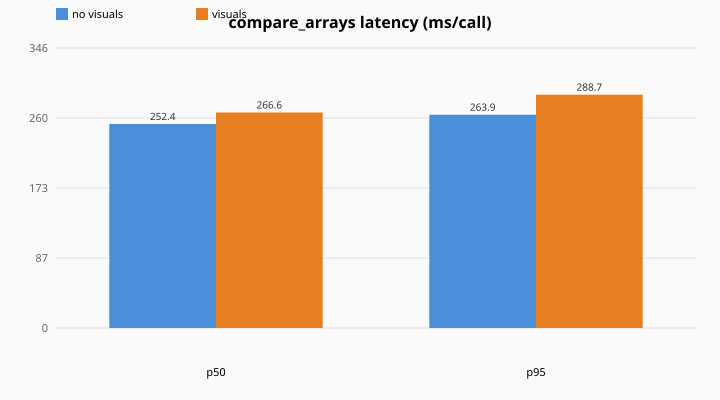
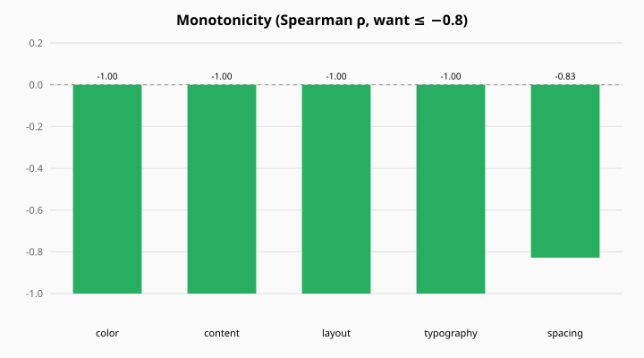
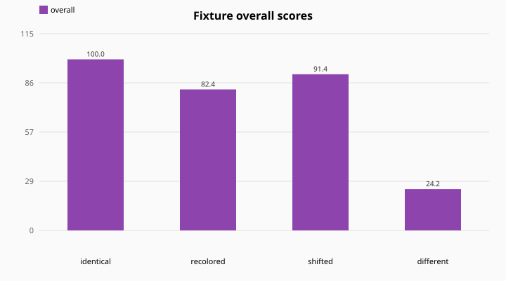
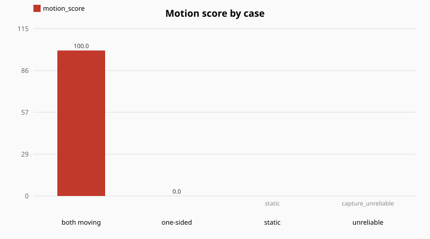

# design-compare-mcp

An MCP server for comparing UI screenshots and sampled motion. It returns heuristic scores,
diagnostic images and suggested fixes to support visual review.

**Website:** [codenameakshay.github.io/design-compare-mcp](https://codenameakshay.github.io/design-compare-mcp/) — overview, the five dimensions, install steps, and browser-only formula illustrations, not full worker comparisons ([source in `site/`](site/)).

It compares along two axes most tools ignore in combination:

- **Static comparison** (`compare_designs`) — layout, color, content, typography, spacing of a still frame.
- **Motion diagnostics** (`compare_motion` + `capture_frames`) summarize frame-to-frame change.
  Similar energy or correlation alone does not establish matching animation.

This document explains what each score means, how it is computed, the historical human-label
calibration, and **where it is weak and can mislead you**. If a number
looks wrong, the [Calibration](#calibration-is-it-any-good) and [Known limitations](#known-limitations--how-it-can-be-wrong)
sections are written so you can tell whether it's the UI or the tool.

See [PLAN.md](PLAN.md) for the original design rationale and [calibration/README.md](calibration/README.md)
for the calibration workflow.

## Contents

- [The idea](#the-idea)
- [Install & register](#install--register)
- [The tools](#the-tools)
- [How a comparison works (the pipeline)](#how-a-comparison-works-the-pipeline)
- [The five dimensions](#the-five-dimensions)
- [Aggregation: weighted geometric mean](#aggregation-weighted-geometric-mean)
- [Presets & weights](#presets--weights)
- [Reading the diagnostic images](#reading-the-diagnostic-images)
- [Motion comparison](#motion-comparison)
- [Calibration: is it any good?](#calibration-is-it-any-good)
- [Known limitations & how it can be wrong](#known-limitations--how-it-can-be-wrong)
- [Architecture](#architecture)
- [Hardening, determinism & trust model](#hardening-determinism--trust-model)
- [Configuration](#configuration)
- [Benchmark](#benchmark)
- [Development](#development)
- [Repo layout](#repo-layout)

## The idea

You have a **reference** and a **candidate** screenshot or cropped widget. Use scores to locate
differences, not as a guarantee of perceptual progress. Keep inputs and settings comparable, inspect
dimensions and diagnostics, and verify behavior separately. A static comparison returns:

- an **`overall`** 0–100,
- five **sub-scores** with `scored`, `not_applicable` or `failed` status,
- **`diagnostics`** with review/inconclusive status, capture observations, scope and alignment evidence,
- **`provenance`** with decoded-input identities, resolved settings and comparison/run keys,
- **`cv_findings`** with suggested color, region, spacing and text corrections to confirm visually,
- **diagnostic images** the calling model can look at,
- a **`critique_rubric`** telling the host how to turn all of that into a prioritized fix list.

## Install & register

Requirements: **Node ≥ 20**, **Python ≥ 3.10**, and (for `capture_frames`) a local **Chrome/Chromium**.
`extract_video_frames` additionally requires **FFmpeg and ffprobe** on PATH. Install them with
`brew install ffmpeg` on macOS or your OS package manager. Nothing is installed automatically.

```bash
npm install
npm run build                         # tsc -> dist/
python3 -m venv worker/.venv
worker/.venv/bin/pip install -e './worker[cv]'
npm run smoke                         # end-to-end check; ends with ALL CHECKS PASSED ✅
```

Register with Claude Code (user scope = available in every project):

```bash
claude mcp add design-compare --scope user -- node /abs/path/to/design-compare-mcp/dist/index.js
```

Register with Cursor by adding this to `~/.cursor/mcp.json`, then restart Cursor:

```json
{
  "mcpServers": {
    "design-compare": {
      "command": "node",
      "args": ["/abs/path/to/design-compare-mcp/dist/index.js"]
    }
  }
}
```

Rebuild (`npm run build`) and restart your session after any change — the registered server runs the
built `dist/`.

## The tools

Five tools: `ping`, `compare_designs`, `compare_motion`, `capture_frames`, `extract_video_frames`.

Use absolute local image/frame paths with comparison tools. Relative paths resolve in the MCP
server's working directory, which can differ from the calling project. Extraction returns absolute
paths ready to pass through without reconstructing filenames.

### `compare_designs` — static comparison

Inputs: `reference` (path), `candidate` (path), `mode` (`"widget"` | `"screen"`), optional
`preset` (`"default"` | `"dark-ui"`), `weights`, `ignoreRegions`, `comparisonContext`, `returnVisuals`.

`ignoreRegions` are `[x, y, w, h]` boxes in **original reference image pixels** (before the
768 px normalization). Finding boxes in `cv_findings` are reported in the **canonical 768-wide**
canvas space — use the returned `canvas` mapping to translate between the two. Masks fill pixels
with each image's own modal edge color before metrics; they are **not true exclusion**. Different
fills can still affect scores. Fully masked results are `inconclusive` even if `overall` is high.

Historical example from the earlier pipeline, **not current output**. The old palette measurements,
findings and numbers below have not been regenerated; current results also include statuses,
diagnostics and provenance:

```jsonc
// compare_designs(reference="reference.png", candidate="recolored.png", mode="screen")
{
  "overall": 82.4,
  "subscores": {
    "layout":     { "score": 99.97, "reason": "structural similarity (SSIM) after alignment",
                    "measurements": { "ssim": 0.9997, "alignment": { "method": "ecc_translation", "cc": 1.0, "dx": -0.0, "dy": -0.0 } } },
    "color":      { "score": 43.95, "reason": "dominant-palette match (mean ΔE2000)",
                    "measurements": { "mean_delta_e": 15.62, "palette_size": [6, 6], "top_deltas": [45.2, 28.6, 18.2, 1.6] } },
    "content":    { "score": 100.0, "reason": "reference-region coverage (IoU matching)",
                    "measurements": { "coverage": 1.0, "ref_regions": 8, "cand_regions": 8, "missing": 0, "extra": 0 } },
    "typography": { "score": null,  "reason": "text amount + scale (coarse; not font identity)",
                    "measurements": { "note": "no text detected in either image" } },
    "spacing":    { "score": 100.0, "reason": "block margins + vertical rhythm (coarse)" }
  },
  "cv_findings": [
    { "area": "color", "type": "color_shift", "severity": "high",
      "observed": "a dominant color reads as #dc3c3c but the reference uses #2878dc (ΔE 45)",
      "suggested_fix": "shift #dc3c3c toward #2878dc" },
    { "area": "color", "type": "color_shift", "severity": "high",
      "observed": "a dominant color reads as #78283c but the reference uses #283c78 (ΔE 29)",
      "suggested_fix": "shift #78283c toward #283c78" }
  ],
  "preset": "default",
  "weights": { "layout": 0.35, "color": 0.2, "content": 0.15, "typography": 0.15, "spacing": 0.15 }
}
```

In that historical result, layout and content heuristics scored highly while color scored lower.
The findings suggested palette changes, not verified semantic fixes. `typography` was `null` because
the detector found no text in either image; that dimension was excluded from `overall`.
The old color measurement fields in this example are removed, with no compatibility aliases.
See the [current color measurement API](calibration/README.md#color-measurement-api) for their replacement.
The historical `color_shift` entries do not use the current two-certificate finding contract.

Historical finding from removing the CTA button:

```jsonc
{ "area": "content", "type": "missing_region", "severity": "high", "box": [229, 1150, 312, 92],
  "observed": "a reference region at x=229,y=1150 (312x92) is absent",
  "suggested_fix": "add the missing element at this position" }
```

### Comparing revisions without changing the question

1. Retain the reference and baseline candidate. Fix the intended state, viewport, crop origins and
   sizes, masks, mode, preset and weights. Record these in an immutable external protocol manifest.
   Hash its exact bytes with `shasum -a 256 /absolute/path/to/protocol.json`.
2. Pass `comparisonContext: {scopeId, protocolKey}` to `compare_designs`, using a 1–128 UTF-16-unit scope ID
   and that lowercase SHA-256 digest. This is caller-declared metadata, not capture verification.
   When omitted, the worker cannot know external state or crop origins.
3. Compare both the saved baseline and revised candidate against the same reference and setup.
   Require matching `provenance.comparison_key` values before reporting a score delta.
   `run_key` additionally identifies candidate pixels, so candidate-only changes keep the comparison
   key but change the run key when decoded pixels change. Paths and `returnVisuals` do not split keys.
4. If a key is missing or differs, re-score the saved baseline under the new setup first. A worker
   source/runtime, reference, settings or declared context change starts a new comparison series.
   Rebuild/restart after implementation changes. Keys do not establish visual progress or validate
   the external manifest. Review diagnostics, screenshots and behavior before accepting a change.

If an intentional omission, such as a header or avatar, changes the flow below it, a mask does not
restore correspondence. Crop both inputs to the same retained widget, declare the crop origins and
scope in a new protocol, and use `mode: "widget"`. Re-score the baseline using that same scope.
Report this as a scoped widget comparison, not a whole-screen improvement or proof that omitted
content matches.

### `compare_motion` — temporal comparison

Inputs: `reference`, `candidate` (each a **directory of frames** or an **array of frame paths**
captured over time), optional `maxFrames`, `returnVisuals`.

Historical energy-only output, **not current output**. It predates `motion_status`, the
`motion_energy_score` alias and `timing_diagnostics`:

```jsonc
// compare_motion(reference="loader/ref_frames", candidate="loader/cand_frames")
{
  "ref_energy": 0.00474,     // motion in the reference (mean per-frame change)
  "cand_energy": 0.00288,    // motion in the candidate
  "energy_ratio": 0.607,     // min/max — do they animate a similar amount?
  "temporal_corr": 0.639,    // frame-index profile correlation, not verified timing
  "ref_moving": true, "cand_moving": true,
  "motion_score": 60.7       // 0 if one animates and the other is static
}
```

That result showed lower mean frame-to-frame grayscale change in the candidate under that sampling
setup. It did not measure distance traveled or verify rhythm. Current output reports energy-only
score semantics and inconclusive timing; see [Motion comparison](#motion-comparison).

### `capture_frames` — get frames for `compare_motion`

Inputs: `url` (**http or https only**), optional `frames`, `intervalMs`, `clip` (crop to a preview),
`viewport`, `waitMs`, `waitForFlutter` (waits for `<flutter-view>` to mount — the outcome is always
reported as `flutterWait`), `actions` (ordered click/hover/wait steps to navigate an SPA or trigger
an interaction before sampling), `outDir`. Drives headless Chrome, writes a PNG sequence, and returns
the output `dir`, ordered `frames` paths, and first/last sample images. **`frames: 1`**
captures a still (pass the frame path to `compare_designs`). When `DESIGN_COMPARE_ALLOWED_ROOTS` is
set, use an explicit `outDir` inside one of those roots for subsequent Python comparisons. Node's
registration of a default capture temp directory does not extend the Python read allowlist.

### `extract_video_frames` — bounded local recording samples

```json
{
  "videoPath": "/absolute/path/to/recording with spaces.mp4",
  "startMs": 1500,
  "durationMs": 1000,
  "fps": 5
}
```

`videoPath` must be an absolute regular local `.mp4` or `.mov` file. `startMs` defaults to 0.
`durationMs` is required, an integer from 1 through 20000. `fps` is an integer from 1 through 30,
default 5. Unknown fields are rejected. The window must fit the video stream duration and
`ceil(durationMs * fps / 1000)` must not exceed 120. There is no output-directory, crop, alignment,
or arbitrary decoder-option input.

Requests occur at `startMs + i * 1000 / fps` in the half-open window
`[startMs, startMs + durationMs)`. The first actual decoded presentation frame at or after each
request is selected, only if it is inside that window. Selection uses integer source PTS, not an
`fps` filter or frame-index timestamps. Times normalize the first decoded source PTS to zero.

The result contains a fresh `dir`, `manifestPath`, ordered absolute PNG `frames`, and `manifest`.
Each unique selected source frame is exported once. `manifest.frames` records its `path`, actual
normalized `actualMs`, and original integer `pts`. `manifest.samples` preserves every requested
position with one of these shapes:

- `{kind: "selected", requestedMs, frameIndex}` selects a new frame.
- `{kind: "shared", requestedMs, frameIndex}` points to an already exported source frame.
- `{kind: "unavailable", requestedMs}` has no frame before the exclusive end.

`manifest.sampling` is `complete`, `sparse` when requests share frames, or `incomplete` when any
request is unavailable. An empty selection errors. Out-of-range windows error rather than trim.
Identical pixels at different source PTS remain separate frames. Missing, duplicate, or decreasing
decoded PTS error. No repeated files or fabricated uniform motion sequence fill missing samples.

The manifest also records the SHA-256 of the exact private source snapshot decoded, source byte
size/duration/codec, encoded and oriented dimensions, rotation/display matrix, time base, input
window/cadence, and tool/Node/FFmpeg/ffprobe versions. FFmpeg applies orientation; non-square pixels,
non-orthogonal rotations, and changing dimensions are unsupported. Audio and source metadata are
not copied into PNGs. The source snapshot is deleted before success.

Output files and their directory become read-only, are never reused or overwritten, and remain
until you remove them. This is filesystem read-only protection, not tamper-proof archival storage.
To delete a retained bundle, restore owner write permission on its directory first. When
`DESIGN_COMPARE_ALLOWED_ROOTS` is set, the server creates output inside the first writable existing
allowed root. It never falls back outside the allowlist. Both comparison tools can therefore read
the returned frames without a Python allowlist exception. No writable allowed root means an error.

Limits per call are 512 MiB source, 16 megapixels and 12000 pixels per frame side, 120 requested
samples, 480 million exported pixels, 12000 observed decoded frames / 12 billion decoded pixels,
256 MiB combined subprocess output, 4 MiB decoder diagnostics, and a shared 60-second processing
deadline. Probe/version output is capped at 1 MiB per process. At most two extractions run at once;
each decoder uses one thread. A single decoder allocation is capped at 64 MiB. Keyframe preroll is
also subject to the deadline; the observed-frame budget starts at FFmpeg's accurate-seek output.
Partial output from failed calls is removed. Limits fail explicitly without resizing or shortening
the requested evidence.

Cancelling a request stops its decoder and removes its private source copy and partial output
before releasing the extraction slot. Graceful server shutdown waits for this cleanup too.

The decoder uses argument arrays, forces the MOV/MP4 demuxer, disables external data references and
absolute aliases, and permits only the `file` input protocol. Playlists, URLs, external-reference-only
recordings, and unsupported/corrupt media error. It never downloads inputs. FFmpeg is a native local
decoder, not an OS sandbox; keep it patched and do not treat this as isolation for hostile tenants.

Pass `frames[0]` to `compare_designs` for a reviewed matching state, or `frames` to `compare_motion`
for independently verified matching interactions. Inspect both manifests for actual cadence and
sparse/incomplete sampling first. The motion tool consumes paths, not timestamps, so it cannot
enforce matched timing or semantics. Preserve `static` / `capture_unreliable` with null scores.
Extraction itself makes no similarity claim and does not change scoring.

### The motion flow — fully agent-driven

```
capture_frames(url = reference-component-url, clip = {…})                       → dir_ref
capture_frames(url = candidate-url, waitForFlutter = true,
               actions = [{click:[x,y], wait:1500}], clip = {…})                → dir_cand
compare_motion(reference = dir_ref, candidate = dir_cand)
```

## How a comparison works (the pipeline)

`compare_designs` runs a fixed pipeline. Understanding the stages is the key to trusting (or
distrusting) a score.

1. **Load** — decode both images to RGB. Inputs are size-capped *before* decode (see [hardening](#hardening-determinism--trust-model)).
2. **Normalize** — resize both to a canonical width (**768 px**, aspect preserved), then pad the shorter
   to the taller so metrics operate on equal-sized canvases. A height/aspect divergence is recorded and
   surfaced as an `aspect_mismatch` finding rather than silently distorting the score.
3. **Align** — register the candidate onto the reference:
   - `screen` mode → ECC translation (`cv2.findTransformECC`), falling back to identity if it doesn't
     converge (flagged in diagnostics);
   - `widget` mode → identity (a tight crop is assumed pre-aligned).
4. **Score five dimensions** — each in isolation. A metric that throws on a degenerate input marks
   that dimension **`failed`** with score floored at **1.0** and still contributes to `overall`; a
   dimension that doesn't apply returns `null` and is excluded.
5. **Aggregate** — weighted geometric mean over the scored dimensions.
6. **Diagnostics and provenance** — report caveats and decoded-input/settings identities, then render
   diagnostic images unless `returnVisuals:false`. `diagnostics.status` is `ok`, `review` or
   `inconclusive`. `ok` is not capture verification or a design pass. Near-uniform input is an
   observation, not proof of capture failure. Failed metrics remain measurement failures, not defects.

**Only `layout` uses the aligned candidate.** SSIM is hypersensitive to a 1-px offset, so the global
shift is registered away and layout measures *shape*. The other four run on the **unwarped** candidate
on purpose. Color compares distributions, typography compares amount/scale, and content/spacing remain
position-sensitive. This avoids warp-interpolation artifacts in those dimensions. Inspect alignment
`outcome`/`reason` and `diagnostics.layout_identity_score` alongside aligned layout. Rejected `dx`/`dy`
describe attempted, not applied, translation; offsets are in canonical pixels. Alignment does not
verify matching state, and no metric guarantees that a real misplacement becomes a finding.

**Modes.** `widget` = a tight crop of one component, strict, no alignment. `screen` = a full view,
tolerant, auto-aligned. Choose `widget` when you can crop to the exact component (best signal); `screen`
for whole pages.

## The five dimensions

| Dimension | Default weight | Measures | Differences it targets | Known weakness |
|---|---|---|---|---|
| **layout** | 0.35 | structural similarity | shapes/structure differ, blur, alignment fails | grayscale (blind to color); plateaus under heavy blur |
| **color** | 0.20 | global projected color mass and soft rare-color coverage | color proportions or coverage differ | no region correspondence; fixed-grid proxy, not CIEDE2000 or 3D optimal transport |
| **content** | 0.15 | are the reference's blocks present & placed | elements missing/extra/moved | coarse segmentation; region boxes wobble |
| **typography** | 0.15 | amount + scale of text | more/less text, larger/smaller type | **not** font identity; `null` when no text |
| **spacing** | 0.15 | margins + vertical rhythm | margins/gaps differ | coarsest; `null` on sparse views; full-width blocks zero the L/R margins |

Details of each:

- **layout (structure).** SSIM (`skimage.metrics.structural_similarity`) on the aligned grayscale
  images; window clamped to `min(7, h, w)` so thin/tiny canvases don't error. Score = `clamp(SSIM,0,1)×100`.
  The SSIM difference map also drives the diff-heatmap visual.
- **color.** The worker uses one fixed soft lattice for every image, without
  unique-color cutoffs, clustering, shortlists, or an exact-small fallback. Every normalized pixel
  contributes mass to a step-4 lattice in chroma-compressed D65 Lab coordinates. Mass distance `M`
  is the maximum exact 1D Wasserstein distance over 64 fixed projections of that lattice.
  A separate soft rare-color coverage distance `S` uses density-capped weights and multiradius
  clearance. Source-query `alpha = 0.05 / max(local_density, 0.05)` scales both own and target
  occupancy in each direction. Effective query mass resolution is `0.001 / alpha`.
  Score is `100 × exp(−max(M, 0.9 × S) / 19)`. These are heuristic proxy units,
  not CIEDE2000, exact color matching, or 3D optimal transport.
  Measurements identify `metric: "soft_grid_source_density_scaled_clearance_v2"` and
  `units: "chroma_compressed_lab_proxy"`. `mass_distance` is `M`, `coverage_distance` is raw `S`,
  and `weighted_coverage_distance` is `0.9 × S`. `distance` is the maximum of the mass and weighted
  coverage distances, with `decay: 19`. The [color measurement API](calibration/README.md#color-measurement-api)
  describes the nested method metadata and removed legacy fields.
  `color_distribution` reports projected-mass distance when `M ≥ 5`, even when coverage is larger.
  Missing or added findings require conservative absence certificates with a lattice uncertainty
  guard and at least 0.1% certified image mass. `color_shift` summarizes two certified unmatched
  masses, one on each side. It does not mean any recoloring. A missing absence certificate is not
  proof of presence or of a nearby counterpart.
  If no other color finding exists, `color_coverage_deficit` reports `0.9 × S ≥ 1` without claiming
  exact absence. Findings do not establish spatial correspondence, transport edges, or a percentage
  of pixels moved beyond a color-distance threshold. Equal-histogram spatial swaps remain invisible.
  Normalization, padding, and mask fills affect distributions. The frozen v2 contract has passed
  [local color qualification and independent review](docs/reliability/limitations/README.md).
  Full-project checks (`npm test` and `npm run lifecycle`) passed locally.
  Hosted CI, merge, and deployment remain unverified.
  See the [color policy and regression checks](calibration/README.md#color-policy-and-regression-checks)
  for frozen constants, score recalibration, and remaining gates, and the [worker source](worker/vision_worker/metrics/color.py).
- **content-presence.** A **contrast-adaptive** detector (Otsu-thresholded brightness delta from the
  modal background, **unioned** with a gradient/edge mask) segments major blocks, morphologically
  closed and connected-component-labeled. Reference regions are matched to candidate regions by IoU ≥ 0.3;
  score = `100 × coverage × (1 − 0.5·min(1, extra_ratio))`. Unmatched reference regions become
  `missing_region` findings (with boxes); unmatched candidate regions become `extra_region`. Returns
  `null` if the reference has no detectable blocks.
- **typography.** Text lines are found by morphology (gradient → Otsu → wide horizontal close →
  aspect/size filter) — **not** OCR or font matching. Score blends text *amount* (foreground area
  fraction) and *scale* (median line height) as min/max ratios. Font family/weight is explicitly left
  to the host's vision model. `null` when neither side has detectable text.
- **spacing.** From **major** blocks only (a larger min-area than content, so inner text/detail doesn't
  dilute it): outer margins (left/right/top/bottom, normalized) + mean inter-block vertical gap. Each
  feature is compared with a tolerance (a 12%-of-dimension difference = full miss); score = mean of the
  per-feature similarities. `null` when there are too few major blocks to assess rhythm.

## Aggregation: weighted geometric mean

`overall` is the **weighted geometric mean** over the dimensions that scored (non-`null`), with weights
renormalized across that subset and each score floored at 1.0:

```
overall = exp( Σ (wᵢ / Σw) · ln(clamp(scoreᵢ, 1, 100)) )
```

A weighted geometric mean penalizes low numeric dimensions more than the arithmetic mean for the
same clamped scores and weights. It does not prevent gaming, detect unmeasured errors or establish
perceptual validity. `failed` dimensions retain their numeric floor; `null` dimensions are excluded.
No numeric dimensions returns 0. If all remaining numeric dimensions have zero weight, the current
implementation returns 1. Inspect statuses and effective weights before interpreting `overall`.

## Presets & weights

The default weights are a balanced starting point, **not** a universal truth — the right weighting
depends on the domain (see [Calibration](#calibration-is-it-any-good)).

- **`default`** — `layout 0.35, color 0.20, content 0.15, typography 0.15, spacing 0.15`.
- **`dark-ui`** — `layout 0.60, typography 0.30, color 0.10, content 0, spacing 0`. Historical tuning
  on a dark component-library port down-weighted color and disabled content/spacing. Its earlier
  human-label correlation is not validation of the current pipeline.

Pass `preset: "dark-ui"`, or override any dimension with explicit `weights` (which take precedence over
the preset). The resolved preset + weights are echoed back in every result for transparency.

## Reading the diagnostic images

`compare_designs` returns up to four images (as MCP image blocks); `compare_motion` returns one:

- **overlay** — filled reference and aligned, filled candidate blended 50/50. Alignment and mask
  fills can hide differences; this is not the original unwarped pair.
- **diff_heatmap** — aligned grayscale SSIM divergence, not a color-error map. Inferno maps
  `clip(1 − SSIM, 0, 2) / 2` to intensity on a fixed scale. Omitted if layout fails.
- **content_regions** — unaligned previews with red ignore hatching. Green boxes mark matched
  regions and red boxes missing regions on the reference; orange extras appear on a second candidate
  pane when needed. Boxes describe filled-canvas detections, not semantic elements.
- **side_by_side** — unaligned normalized/padded previews with ignore hatching, not the metric fills.
- **motion_signature** — green reference and blue candidate share a peak-normalized intensity scale.
  Each sequence spans the chart width independently. The horizontal axis is relative frame index,
  not verified time; unequal-length curves must not be read as time-aligned.

Unaligned static panes use the returned canonical `canvas` mapping. Divide coordinates by the
corresponding input's `scale` to recover original pixels. Overlay and heatmap use registered
reference-canvas positions; account for the accepted warp before mapping back to the original
candidate. These views do not all share alignment or mask rendering.

## Motion comparison

A single frame can't measure animation, so `compare_motion` compares two **frame sequences**.
The loader converts each frame to grayscale at a fixed working size before these calculations:

- **Signature** — mean absolute grayscale change divided by 255 for each consecutive frame pair.
- **Motion energy** — mean of the signature. A side moves when energy is greater than 0.0008.
- **`motion_status`** — `compared`, `static` when neither side moves, or `capture_unreliable` when
  either sequence consists entirely of near-uniform frames, each with grayscale standard deviation
  below 2. This observation does not establish why the capture is uniform.
- **`motion_score` / `motion_energy_score`** — identical energy-only values: `min/max × 100` when
  both move, 0 when only one moves, and `null` for `static` or `capture_unreliable`.
  `motion_score_meaning` is `motion_energy_similarity_only`.
- **`timing_diagnostics`** — always `inconclusive`, with `score: null` and `cadence_verified: false`.
  Inputs contain no timestamps. Its reason and recommendation explain what to recapture or inspect.
  `sampled_profile.correlation`, also returned as `temporal_corr`, is Pearson correlation of equal-length
  frame-index signatures only. It is `null` for unequal lengths, insufficient/constant profiles,
  unreliable/static captures or a motion-presence mismatch. Signatures are not stretched or truncated.

Energy does not measure direction, path, easing or interaction correctness. Different content,
contrast, moving pixel area, duration and sampling cadence can change it. Even matching energy and
profile correlation do not establish animation fidelity. Review timestamped captures independently.

## Calibration: is it any good?

The following tables describe an **earlier scoring pipeline**, not current reliability changes.
They have not been revalidated. The original labeled run has no retained exact version provenance.
It used 26 components of a dark motion-component library (beUI) vs. its Flutter port, each scored 0–100 by eye
(blind to the tool's output). Correlation is **Spearman** (does the tool *rank* ports the way a human
does?).

| Configuration | Spearman vs. human labels |
|---|---|
| `default` preset, out of the box | **−0.03** — essentially no correlation |
| `default` preset, after fixing dark-UI segmentation | **+0.14** |
| **`dark-ui` preset** | **+0.44** |
| best weighting found in a search over 3 dims | +0.54, fitted to the same 26 pairs, not held-out validation |

Per-dimension correlation with human judgment **on that dataset**:

| Dimension | Spearman | Reading |
|---|---|---|
| layout | **+0.33** | the strongest single predictor |
| typography | **+0.31** | comparably useful |
| content | +0.23 | useful after the dark-UI fix (was −0.02 noise before) |
| color | +0.03 | little ranking signal on this dataset with the old color metric |
| spacing | −0.13 | weak/noisy on sparse dark previews |

These historical correlations describe that dataset only. A finite weight search is not a universal
ceiling, and fitting and evaluating on the same labels can overstate generalization. Synthetic
regression checks do not replace fresh human-label calibration of the changed pipeline.
The current color metric changes the distance definition and score scale. Historical color
scores and exact-CIEDE2000 numeric anchors are not current targets. Re-score saved baselines under
the new metric version before comparing revisions. Available labeled evidence remains weak;
prototype checks do not qualify the production implementation or establish universal accuracy.

**Re-calibrate for your own UI:** drop `(reference, candidate, your 0–100 label)` pairs into
`calibration/` and follow [the manifest-based workflow](calibration/README.md). Report dataset scope,
sample count and tool/runtime versions. Use held-out pairs to evaluate tuned weights; no fixed pair
count guarantees a reliable accuracy estimate. `scripts/calibrate.py` is the historical beUI-specific
helper with embedded labels and crop paths, not a general manifest runner.

## Known limitations & how it can be wrong

Read this before trusting any single number.

- **Static comparisons miss motion.** On the historical calibration
  set, *every one of the 8 largest tool-vs-human disagreements was a motion/interaction component* the
  static tool **over-scored** (e.g. animated-toast-stack: human 25, tool 80; tooltip: 50 vs 87). If a
  component's fidelity is mostly about motion, inspect sequences too. `compare_motion` diagnostics
  do not by themselves establish animation fidelity.
- **Historical color calibration is dataset-specific.** The old color metric had rho +0.03 on that
  dark-library dataset. This does not make palette errors irrelevant in every single-theme UI.
  `dark-ui` sets color weight to 0.10, not zero; validate weights for your own task.
- **Color-mass ordering is not universally monotonic.** The [independent close-hue review](docs/reliability/limitations/independent-review.md#non-blocking-limitation-close-hue-mass-ordering)
  records a score increase from 98.13474 to 98.60238 when recolored mass grows from 2.5% to 5%,
  with no findings. Retained finite sweeps do not establish general monotonicity or perceptual accuracy.
- **content & spacing are coarse.** They rely on pixel segmentation with no DOM. The adaptive detector
  repaired historical low-contrast cases, but region boxes still wobble and spacing goes `null` on
  sparse previews. A detected region does not establish semantic correspondence.
- **typography is amount + scale, not font.** It will not notice a wrong font family or weight — that's
  deliberately left to a vision model. Two very different fonts at the same size and density score high.
- **One-shot animations under `capture_frames`.** An animation that ends before sampling can be missed.
  Both-static and unreliable captures return null scores, not proof of matching animation. Inspect
  the frames, status and actual timing even for continuous animations.
- **Headless rendering can fail.** Inspect Flutter and other captures for blank frames, startup
  failures and wrong state. No renderer choice guarantees a reliable capture.
- **Correlation is not acceptance.** The historical +0.44 on n=26 is not a current accuracy estimate
  or an acceptance threshold. Review images and behavior separately.
- **Different example content.** If the two sources show different sample data (a `select` showing
  "Next.js" vs "Pick a fruit"), static and motion measurements can both change. Match sample content
  or declare a narrower comparison scope rather than attributing every difference to the product.

## Architecture

```
Host agent ──MCP/stdio──► TS server ──spawns once──► Python vision worker (persistent)
                              │
                              └── capture_frames → headless Chrome (puppeteer-core)
```

- **TS server** (`src/`) speaks MCP over stdio, registers the tools, drives `capture_frames` directly
  (browser work is a Node concern), and supervises the Python worker.
- **Python worker** (`worker/vision_worker/`) does all vision (OpenCV, scikit-image, scikit-learn). It
  stays **resident** so heavy imports load once, not per call. TS ↔ Python speak newline-delimited JSON;
  the worker's stdout is a clean protocol channel and all diagnostics go to stderr.

## Hardening, determinism & trust model

- **Repeatability.** Repeated inputs and settings are expected to reproduce scores under the same
  tool version and environment. This is not proof of perceptual accuracy or safety as an optimization
  target. Provenance identifies decoded pixels and resolved settings, not verified capture state.
- **Supervised worker.** If the Python worker dies (OOM, native crash), the next request lazily
  respawns it with backoff; a previously-healthy crash triggers one idempotent retry. One crash costs a
  single failed call, never the session.
- **Per-metric isolation.** A dimension that throws on a degenerate input is marked `failed` with score
  floored at 1.0 (error in `measurements`); the others and `overall` still compute. Not-applicable
  dimensions return `null` and are excluded from the geo-mean. Inspect `diagnostics` before ranking;
  numeric scores are preserved even when the comparison scope is inconclusive.
- **Input caps.** Images larger than ~40 MP / 12000 px per side are rejected *before* decode (bounding
  memory); PIL's decompression-bomb guard is a backstop; non-images and bad paths return typed errors.
- **Protocol isolation.** The worker reserves the real stdout fd for framed JSON and repoints
  `sys.stdout`/fd 1 at stderr, so stray library output can never corrupt the channel.
- **Trust model.** The tools read local image paths and (for `capture_frames`) navigate to URLs you
  give them; a local single-user assumption. They never return raw file bytes (non-images error out).
  For an untrusted/multi-tenant host, set `DESIGN_COMPARE_ALLOWED_ROOTS` to restrict file reads.

## Configuration

- `DESIGN_COMPARE_PYTHON` — Python interpreter for the worker. Defaults to `worker/.venv/bin/python` if
  present, else `python3`.
- `DESIGN_COMPARE_CHROME` — Chrome/Chromium executable for `capture_frames`. Auto-detected on
  macOS/Linux/Windows if unset.
- `DESIGN_COMPARE_FFMPEG`, `DESIGN_COMPARE_FFPROBE` — optional executable paths for recorded-video
  extraction. Default to `ffmpeg` and `ffprobe` on PATH. Missing executables return installation guidance.
- `DESIGN_COMPARE_ALLOWED_ROOTS` — optional path-separated directories (`:` on macOS/Linux, `;` on Windows). When set, file reads and `capture_frames` `outDir` outside them are refused (after resolving symlinks). Unset = any local path.

## Benchmark

The table, four charts and linked JSON below are a **historical local benchmark snapshot of the old
pipeline**, not current measurements. The JSON lacks commit, timestamp, hardware and dependency
provenance. `npm run bench` regenerates `docs/bench/results.json` and all four SVGs; refresh them
together before publishing new numbers.

Ordering checks cover finite synthetic perturbations. The geometric/arithmetic example checks
aggregation, not resistance to all metric gaming. Latency is separate evidence. The old motion
controls do not test wrong direction, path or timing with similar energy.

| Metric | Result |
|---|---|
| Latency (`visuals=false`, p50 / p95) | **252 / 264 ms/call** |
| Latency (`visuals=true`, p50 / p95) | 267 / 289 ms/call |
| RSS growth (80 in-process calls, visuals=true) | +1.1 MB |
| Synthetic ordering Spearman (color / layout / spacing) | −1.00 / −1.00 / −0.83 |
| Aggregation (geo vs arith on `{layout:12, color:100, …}`) | **34.6 vs 56.0** |
| ignoreRegions (without → with ignore) | 51.1 → 80.2 (+29.1) |
| Motion: both-moving / one-sided / static / unreliable | 100 / 0 / null / null |
| Fixture overall: identical / recolored / shifted / different | 100 / 82.4 / 91.4 / 24.2 |









See [`docs/bench/results.json`](docs/bench/results.json) for the full structured output.

For reproducible baseline/current synthetic evidence, use [`scripts/reliability-benchmark.py`](scripts/reliability-benchmark.py)
and the commands, generator version, and case counts in [`docs/reliability/`](docs/reliability/).
The final run targets `docs/reliability/runs/final`. Publish
current measurements only after a complete integrated run against the exact source snapshot and
retained-evidence verification. Preliminary runs and
historical results do not validate the current implementation or establish perceptual accuracy.

## Development

```bash
npm test             # build + extraction + Python regression scripts + smoke + resilience
node scripts/extract-video-test.mjs # focused real-video + restricted-root MCP tests, after build
npm run bench        # latency, RSS, synthetic ordering, aggregation, masks, motion → docs/bench/
npm run build        # tsc -> dist/
npm run smoke        # MCP smoke checks; see script for coverage and skips
npm run resilience   # worker crash/restart + concurrency
npm run lifecycle    # server + worker exit when the host goes away (no orphans)
```

CI (`.github/workflows/ci.yml`) builds TypeScript, installs FFmpeg, runs real-video extraction tests,
Python regression scripts and MCP smoke checks on every PR and push to `main`. Chrome is not required;
`capture_frames` smoke checks skip when Chrome is absent.

Individual Python tests (also run by `npm test`):

```bash
worker/.venv/bin/python worker/tests/test_pipeline.py
worker/.venv/bin/python worker/tests/test_calibration.py
worker/.venv/bin/python worker/tests/test_robustness.py
worker/.venv/bin/python worker/tests/test_motion.py
worker/.venv/bin/python worker/tests/test_color_stability.py
worker/.venv/bin/python worker/tests/test_reliability.py
```

Calibration helpers: `scripts/capture_pairs.mjs` (capture reference/candidate pairs),
`scripts/build_contact_sheet.py` (blind labeling sheet), `scripts/calibrate.py` (score labels + tune
weights), `scripts/capture_frames.mjs` + `scripts/motion_score.py` (motion).

## Repo layout

```
src/                       # TypeScript MCP server
  index.ts                 #   five tools, including extract_video_frames
  worker-client.ts         #   supervises + multiplexes the Python worker
  capture.ts               #   headless-Chrome frame capture (capture_frames)
  extract-video.ts         #   bounded FFmpeg/ffprobe extraction (extract_video_frames)
  schema.ts                #   zod input schemas
  path-and-url-guard.ts    #   http(s) URLs + DESIGN_COMPARE_ALLOWED_ROOTS
worker/vision_worker/      # Python vision worker
  pipeline.py              #   compare / compare_arrays / compare_motion orchestration
  reliability.py           #   diagnostics + decoded-input/settings provenance
  normalize.py align.py    #   canonical-size + registration
  metrics/                 #   structure, color, content, typography, spacing
  aggregate.py             #   weighted geometric mean + presets
  motion.py                #   motion signature + sequence comparison
  visuals.py io_utils.py   #   diagnostic images + image/frame loading
scripts/                   # calibration + motion + resilience/stress helpers
calibration/               # dataset manifest, labeling sheet, (gitignored) captured pairs
worker/tests/              # pytest-free assert scripts (run directly)
PLAN.md                    # original design + phase plan
```
